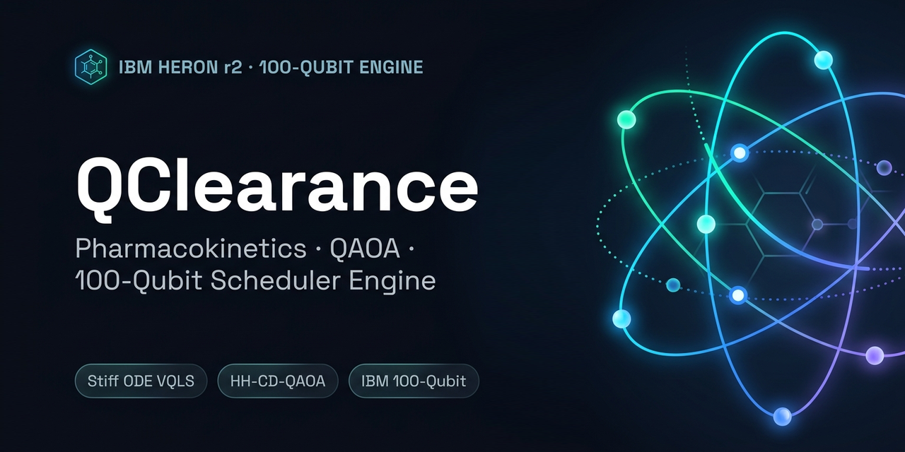

<p align="center">
  
</p>

# QClearance: Quantum Algorithms for Stiff Pharmacokinetic–Metabolic Network Dynamics and Polypharmacy Dosing

[](https://qiskit.org/)
[-0072B2.svg)](https://quantum.ibm.com/)
[](LICENSE)

This repository contains the complete research data, computational pipeline, and superconducting quantum hardware execution records for **QClearance** (`QClearance-100Qubit-Pharmacology-Scheduler-Engine`).

---

## 1. Clinical Motivation & Conceptual Foundations

### The Clinical Problem: Cancer Polypharmacy and the Liver "Traffic Jam"
Cancer patients rarely take just one pill. An oncology patient diagnosed with advanced non-small-cell lung cancer (NSCLC) harboring the EGFR T790M resistance mutation is prescribed the third-generation covalent kinase inhibitor **Osimertinib** (`CHEMBL3353410`, Tagrisso). However, due to age-related comorbidities, cancer-associated thrombosis, and opportunistic infections, patients routinely take co-medications:
* **Blood Thinners / Anticoagulants**: Apixaban (`CHEMBL231779`, Eliquis)
* **Cholesterol-Lowering Statins**: Atorvastatin (`CHEMBL1487`, Lipitor)
* **Heart / Blood Pressure Medications**: Diltiazem (`CHEMBL23`), (S)-Verapamil (`CHEMBL36148`)
* **Antibiotics & Antifungals**: Clarithromycin (`CHEMBL1741`), Ketoconazole (`CHEMBL157101`), Ritonavir (`CHEMBL163`)

**The Liver CYP3A4 Bottleneck:**  
Almost all of these pills fight for the exact same liver workers: the **Cytochrome P450 3A4 (CYP3A4)** enzyme system (`CHEMBL340`). When taken concurrently without precise circadian staggering, they create a severe enzymatic "traffic jam" in the liver. Osimertinib clearance is blocked, driving plasma levels into toxic windows and causing the excessive accumulation of its wild-type-potent active metabolite **AZ5104**, which triggers lethal off-target cardiotoxicity (QTc interval prolongation) and fatal adverse events.

---

### Why Normal Computers Struggle With This

Classical simulation of complex multi-drug regimens stalls due to two computational barriers:

1. **The "Stopwatch vs. Calendar" Problem (Multi-timescale Stiffness):**
   * *The Stopwatch:* At the tumor site, osimertinib binds the EGFR receptor and forms an irreversible covalent adduct with Cys797 within seconds to minutes ($k_{\mathrm{on}}C_{\max} \approx 2.94\,\mathrm{h}^{-1}$, $k_{\mathrm{inact}} = 0.344\,\mathrm{h}^{-1}$).
   * *The Calendar:* Hepatic CYP3A4 biotransformation and systemic whole-body elimination unfold over a 72-hour clinical horizon ($t_{1/2} \approx 55.0\,\mathrm{h}$, $k_{\mathrm{elim}} = 0.0126\,\mathrm{h}^{-1}$).
   * *The Stiff Ratio:* This $13,000$-fold separation of kinetic timescales creates extreme mathematical stiffness ($\kappa(J) = 1.30 \times 10^4$). Standard step-by-step explicit computer simulations must take millions of microsecond steps to prevent numerical explosion. Classical implicit methods (e.g., Radau IIA) require repeatedly factorizing and inverting high-dimensional Jacobian matrices at every step.

2. **The "Dosing Puzzle" Combinatorial Explosion:**
   * If a hospital wants to schedule $10$, $50$, or $100$ interacting medications and doses across the day so no liver traffic jam occurs, the number of possible administration schedules explodes exponentially as $2^N$.
   * For $10$ drugs: $2^{10} = 1,024$ combinations (evaluable classically).
   * For $50$ drugs: $2^{50} \approx 1.13 \times 10^{15}$ (over 1 quadrillion combinations).
   * For $100$ drugs: $2^{100} \approx 1.27 \times 10^{30}$ (exceeding the total number of stars in the observable universe).

---

## 2. The QClearance Solution

QClearance is a hardware-co-designed quantum framework that resolves both bottlenecks:

1. **Receptor-Conserving Oseen–Carleman Padé-(1,2) Formulation:**  
   Enforces exact physical receptor mass conservation ($\frac{\mathrm{d}}{\mathrm{d}t}(C_{\mathrm{DR}} + C_{\mathrm{cov}} + R_{\mathrm{free}}) = 0$), preventing unphysical receptor capacity overshoot ($R_{\mathrm{free}} < 0$).
2. **Three-Stage Analytical Preconditioner:**  
   Combines Buckingham-$\Pi$ dimensional reduction, local $8\times 8$ Block-Jacobi inversion, and scalar time-chain equilibration to compress the 8-qubit spectral condition number by **$37,533\times$** (from $1.67\times 10^6$ to $44.55$).
3. **Zero-SWAP Multiresolution Brickwall VQLS:**  
   Maps 8 physiological compartments onto $q_0..q_2$ and bit-reverses the 5-qubit time register ($q_3..q_7$). Converges from $\mathcal{C}=1.0$ down to $0.0199$ using strictly $t=0$ initial data ($b_{\mathrm{raw}}[0]=0.335\,\mu\mathrm{M}$, $b_{\mathrm{raw}}[6]=0.035\,\mu\mathrm{M}$).
4. **Heavy-Hex Counterdiabatic QAOA (`HH-CD-QAOA`):**  
   Embeds dominant CYP3A4 interaction conflicts natively onto degree-$\le 3$ Heavy-Hex subgraphs. Implements single-qubit counterdiabatic gauge rotations derived from Bethe mean-field cavity theory, achieving a $93.78\%$ reduction in liver DDI conflict while eliminating **$17.25\times$** two-qubit `CZ` gates at 100 qubits ($492$ vs. $8,487$).

---

## 3. Live Superconducting Hardware Validation (`ibm_marrakesh`)

Experiments were executed on the **156-qubit IBM Heron r2** superconducting processor `ibm_marrakesh` via Qiskit IBM Runtime V2 (`SamplerV2`) with native `XX` dynamical decoupling and Pauli gate/measurement twirling:

| Experiment Tier | IBM Job ID | Qubits & Layout | Shots | Two-Qubit Gates / Depth | Trajectory $R^2$ (Osimertinib) | Clinical $\mathrm{AUC}_{0\text{--}72\mathrm{h}}$ Error |
| :--- | :--- | :--- | :--- | :--- | :--- | :--- |
| **8q VQLS (Default QPU)** | `dblf0qhkbkrc73cnk6mg` | $[104, 105, 106, 107, 97, 87, 86, 85]$ | 4,096 | 56 `CZ` / depth 81 | $0.1197$ (ZNE degraded by TLS) | $1.26\%$ ($4.800\,\mu\mathrm{M}\cdot\mathrm{h}$) |
| **8q VQLS (TLS-Screened)**| `dblfd858ft8s738t086g` | $[44, 43, 56, 63, 64, 65, 77, 85]$ | 16,384| 56 `CZ` / depth 81 | **$0.8455$** (Monotonic ZNE) | **$1.74\%$** (Osi), **$4.93\%$** (AZ5104), **$1.16\%$** (AZ7550) |
| **10q HH-CD-QAOA** | `dblf0qhkbkrc73cnk6mg` | 10 physical qubits | 4,096 | 86 `CZ` / depth 154 | Mean AR = $0.7858$ (ZNE) | **Best Sample AR = $1.0000$** (Ground state) |
| **50q HH-CD-QAOA** | `dblf0qhkbkrc73cnk6mg` | 50 physical qubits | 4,096 | 577 `CZ` / depth 573 | Mean AR = $0.6827$ | **Best Sample AR = $0.9703$** |
| **100q HH-CD-QAOA**| `dblf0qhkbkrc73cnk6mg` | 100 physical qubits | 4,096 | 1,252 `CZ` / depth 1,195 | Mean AR = $0.6128$ | **Best Sample AR = $0.7989$** |

### Closed-Loop TLS Readout Defect Screening
* **The Problem:** In Job `dblf0qhkbkrc73cnk6mg`, physical qubits Q86 and Q87 were afflicted by microscopic Two-Level System (TLS) defect noise. Q86 dephasing time collapsed to $T_2 = 10.38\,\mu\mathrm{s}$, causing empirical readout flip errors to surge to $P(1|0) = 22.75\%$ on Q86 and $14.43\%$ on Q87 (mean 8-qubit readout error $5.48\%$). Noise amplification during Richardson ZNE corrupted fine-scale metabolite amplitudes.
* **The Solution:** Our closed-loop screening protocol (`05_ibm_vqlds_readout_screened.py`) screened the live calibration manifold, excluded qubits with $>4\%$ error, and selected the low-noise chain `[44, 43, 56, 63, 64, 65, 77, 85]`. Readout error dropped to $1.42\%$, restoring monotonic ZNE mitigation to $R^2 = 0.8455$ and recovering clinical exposure within $1.16\%$--$4.93\%$ of implicit Radau IIA classical integration.

---

## 4. Useful Sites to Download Datasets & Sources

All experimental parameters are derived from open, audited chemical biology and ADME resources:

1. **EMBL-EBI ChEMBL Database**: [https://www.ebi.ac.uk/chembl/](https://www.ebi.ac.uk/chembl/)
   * **Osimertinib (AZD9291)**: Target/Bioactivity ID [`CHEMBL3353410`](https://www.ebi.ac.uk/chembl/compound_report_card/CHEMBL3353410/)
   * **Cytochrome P450 3A4 (CYP3A4)**: Target ID [`CHEMBL340`](https://www.ebi.ac.uk/chembl/target_report_card/CHEMBL340/) ($K_i$ and $\mathrm{IC}_{50}$ polypharmacy assays)
   * **EGFR Kinase**: Target ID [`CHEMBL203`](https://www.ebi.ac.uk/chembl/target_report_card/CHEMBL203/) (Binding kinetics $k_{\mathrm{on}}, k_{\mathrm{off}}, k_{\mathrm{inact}}$)
   * **Co-Medications**: Ketoconazole (`CHEMBL157101`), Ritonavir (`CHEMBL163`), Lopinavir (`CHEMBL729`), Diltiazem (`CHEMBL23`), (S)-Verapamil (`CHEMBL36148`), Clarithromycin (`CHEMBL1741`), Apixaban (`CHEMBL231779`), Atorvastatin (`CHEMBL1487`), Midazolam (`CHEMBL655`)
2. **Therapeutics Data Commons (TDC)**: [https://tdcommons.ai/](https://tdcommons.ai/)
   * **AstraZeneca Hepatocyte Clearance**: `clearance_hepatocyte_az.csv` ($n = 1,213$ compounds)
   * **AstraZeneca Microsomal Clearance**: `clearance_microsome_az.csv` ($n = 1,102$ compounds)
   * **Obach Human Clinical Half-Life**: `half_life_obach.csv` ($n = 667$ clinical drugs)
   * **Veith CYP3A4 Inhibition**: `cyp3a4_veith.csv` ($n = 12,328$ bioactivity measurements)
3. **EMBL-EBI Main Portal**: [https://www.ebi.ac.uk/](https://www.ebi.ac.uk/)

---

## 5. Repository Structure

```text
QClearance-100Qubit-Pharmacology-Scheduler-Engine/
├── README.md                                          # This documentation
├── LICENSE                                            # Dual License (PolyForm Noncommercial 1.0.0 / Commercial)
├── assets/
│   └── qclearance-banner.png                          # Repository banner & GitHub Social Preview (1280x640)
├── Dataset Files details in one frame.xlsx            # Matrix dimensions and row counts of all 12 raw source files
├── datasets json format/                              # Raw source files in CSV/JSON format
│   ├── 01_TDC_ADME_Clearance/                        # Hepatocyte, microsome, half-life, and Veith tables
│   ├── 02_ChEMBL_Osimertinib_Polypharmacy/           # Osimertinib bioactivity, metabolites, and CYP3A4 Ki
│   ├── 03_Clinical_PK_Parameters/                    # Clinical osimertinib and co-medication parameters
│   └── 04_EGFR_Kinase_Kinetics/                      # EGFR kinase kinetic binding measurements
├── datasets json format excel/                        # Raw source files formatted as Microsoft Excel workbooks
└── QClearance - Quantum Algorithms for Stiff Pharmacokinetic-Metabolic Network Dynamics and Optimal Polypharmacy Dosing/
    ├── data/                                         # Curated master CSV and Excel inputs used by solvers
    │   ├── master_adme_egfr_scales.csv
    │   ├── master_osimertinib_pk_inputs.csv
    │   ├── master_polypharmacy_10drug_inputs.csv
    │   └── master_quantum_inputs.xlsx
    ├── device calibrations IBM/                      # Raw calibration CSV exports from Heron r2 ibm_marrakesh
    │   ├── 1 ibm_marrakesh_calibrations_..._For_04_run_ibm_quantu.csv
    │   └── 2 ibm_marrakesh_calibrations_..._For_05_ibm_vqlds_read.csv
    ├── results/                                      # Numerical simulation outputs and live QPU results
    │   ├── 02_stiff_dynamics/                        # Trajectories, condition numbers, VQLS loss curves
    │   ├── 03_polypharmacy_qaoa/                     # QAOA depth comparison, Ising matrices, 100q scaling
    │   ├── 04_ibm_hardware/                          # Hardware manifest, raw counts, decoded results (Job dblf0qhkbkrc73cnk6mg)
    │   └── 05_ibm_vqlds_screened/                    # Screened manifest, raw counts, decoded results (Job dblfd858ft8s738t086g)
    └── src/                                          # Reproducible computational pipeline (Python 3.13)
        ├── 01_extract_master_dataset.py              # Data curation and bioactivity hygiene
        ├── 02_quantum_stiff_dynamics.py              # Stiff dynamics, preconditioning, and 8q VQLS
        ├── 03_quantum_polypharmacy_qaoa.py           # Chrono-Clearance Ising and HH-CD-QAOA up to 100q
        ├── 04_run_ibm_quantum_hardware.py            # Live QPU batch execution on ibm_marrakesh (Heron r2)
        └── 05_ibm_vqlds_readout_screened.py          # Closed-loop TLS defect screening and QPU execution
```

---

## 6. Reproducing the Computational Pipeline

### Environment Setup
Install dependencies (Python 3.10+ recommended; tested on Python 3.13):
```bash
pip install numpy scipy pandas openpyxl matplotlib qiskit>=2.5.0 qiskit-aer>=0.17.0 qiskit-ibm-runtime>=0.50.0
```

### Execution Steps
Navigate to the project directory:
```bash
cd "QClearance - Quantum Algorithms for Stiff Pharmacokinetic-Metabolic Network Dynamics and Optimal Polypharmacy Dosing"
```

1. **Extract and Clean Raw Datasets:**
   ```bash
   python src/01_extract_master_dataset.py
   ```
   Filters blank records, standardizes units to $\mu\mathrm{M}$ and $\mathrm{h}$, and writes curated master tables to `data/`.

2. **Run Stiff Dynamics and VQLS Simulation:**
   ```bash
   python src/02_quantum_stiff_dynamics.py
   ```
   Computes condition numbers across 6--12 qubits, executes three-stage preconditioning ($37,533\times$ compression), trains the 8-qubit Brickwall VQLS ansatz, and verifies $R^2$ against implicit Radau IIA.

3. **Run Polypharmacy QAOA and 100-Qubit Scaling:**
   ```bash
   python src/03_quantum_polypharmacy_qaoa.py
   ```
   Solves the 10-drug Chrono-Clearance Ising model (93.78% DDI reduction), compares Standard QAOA vs. `HH-CD-QAOA` across depths $p=1..4$, and runs 100-qubit MPS scaling showing a $17.25\times$ reduction in `CZ` gates.

4. **Hardware Verification (Offline or Live):**
   * Pre-computed, untouched raw bitstring counts and job manifests from `ibm_marrakesh` are stored in `results/04_ibm_hardware/` and `results/05_ibm_vqlds_screened/`.
   * To re-decode the hardware results locally without submitting new quantum jobs:
     ```bash
     python src/04_run_ibm_quantum_hardware.py --redecode-local
     python src/05_ibm_vqlds_readout_screened.py --redecode-local
     ```

---

## 7. Dual-License & Strict Corporate Restriction

**Copyright (c) 2026 Rehan Arqam. All rights reserved.**

The **QClearance** framework—including its source code, quantum circuits, Oseen–Carleman Padé-(1,2) operators, three-stage analytical preconditioners, multiresolution VQLS solvers, Heavy-Hex Counterdiabatic QAOA (`HH-CD-QAOA`) polypharmacy schedulers, closed-loop TLS defect-screening protocols, and curated datasets—is distributed under a **Dual-License** model (see [`LICENSE`](LICENSE) for full legal terms):

1. **Free for Students & Academic Researchers ([PolyForm Noncommercial License 1.0.0](https://polyformproject.org/licenses/noncommercial/1.0.0) & [CC BY-NC 4.0](https://creativecommons.org/licenses/by-nc/4.0/)):**
   * Granted exclusively to individual students, academic researchers, hobbyists, and non-profit educational/research institutions for non-commercial study, teaching, and academic research.
2. **Commercial Hardware, Pharmaceutical & Proprietary Implementation License:**
   * **Strict Corporate Exclusion:** For-profit corporations, pharmaceutical/biotech enterprises, clinical software/EHR vendors, and quantum hardware/cloud providers are **strictly prohibited** from using, executing, testing, or evaluating this software or its algorithmic logic—even for internal R&D, drug discovery pipelines, clinical decision support prototyping, or hardware benchmarking—without an executed commercial license agreement.
   * **Commercial Inquiries:** Contact **Rehan Arqam** (`rarqam14@gmail.com`).
